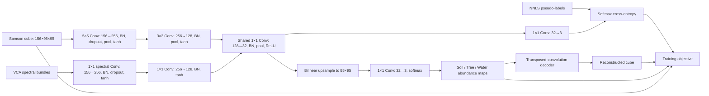

# EGU-Net-ss Simple

EGU-Net-ss Simple is a PyTorch implementation of the spatial-spectral Endmember-Guided Unmixing Network (EGU-Net-ss), configured for the Samson hyperspectral scene. It uses two jointly trained streams: E-Net learns from VCA-derived spectral bundles and pseudo-labels, while UR-Net processes the full image cube to estimate abundance maps and reconstruct the observed spectra.

The Samson setup uses a 95×95 image with 156 spectral bands and three materials: Soil, Tree, and Water. Ground-truth abundances and endmembers are used only for evaluation, after training.

## Architecture



### E-Net

E-Net receives spectral bundles extracted from local image tiles. A global VCA dictionary is estimated from the observed scene; nonnegative least-squares (NNLS) fits against this dictionary provide pseudo-labels. The final 1×1 classifier maps the shared 32-channel features to three material logits and softmax fractions.

### UR-Net

UR-Net processes the complete hyperspectral cube through 5×5 and 3×3 spatial convolutions, average-pooling stages, and the shared 1×1 feature layer. Its abundance head bilinearly upsamples the feature grid to the full image size, applies a 1×1 projection, and uses softmax so each pixel’s nonnegative fractions sum to one. A nonlinear transposed-convolution decoder reconstructs the cube from the abundances.

### Shared layers and training objective

The E-Net and UR-Net streams share the third 1×1 convolution and its batch normalization. Their final abundance projections are separate. Training combines E-Net pseudo-label classification, UR-Net cube reconstruction, linear mixture consistency using scene-derived VCA prototypes, pixelwise NNLS pseudo-abundance supervision, and L2 regularization.

The mixture and pixelwise abundance losses are practical extensions used in this project to encourage physically meaningful abundance maps. The preprocessing and loss setup is therefore an adaptation, not an exact reproduction of every detail in the authors’ original pipeline. See [`docs/paper_reproduction_notes.md`](docs/paper_reproduction_notes.md) for the method differences and limitations.

## Default settings

Settings are defined in [`code/settings.py`](code/settings.py).

| Setting | Default |
| --- | ---: |
| Image size / spectral bands | 95×95 / 156 |
| Materials | 3 (Soil, Tree, Water) |
| Training epochs | 500 |
| Batch size | 128 |
| Optimizer | Adam |
| Learning rate / polynomial power | 0.001 / 0.99 |
| Dropout probability | 0.1 |
| Reconstruction / mixture / abundance loss weights | 1.0 / 1.0 / 1.0 |
| L2 coefficient | 0.00001 |
| Random seed | 1 |
| Preprocessing tiles / local VCA vertices | 5×5 / 3 |

The learning rate is a stability-oriented choice for this implementation; it differs from the paper’s reported base learning rate. The precise deviations are documented in the reproduction notes.

## Run on Samson

1. Place `Samson.mat` and `Samson_GT.mat` in `data/raw/`. The loader expects the Samson cube dimensions (95×95×156) and corresponding ground-truth arrays. Do not pass the ground-truth arrays into preprocessing or training.
2. Install the packages in `requirements.txt` in your Python environment. Install a PyTorch build compatible with your system and NVIDIA driver separately.
3. Open [`code/EGU_Net_Samson.ipynb`](code/EGU_Net_Samson.ipynb) in Jupyter and run its cells from top to bottom. The notebook verifies that CUDA can perform a real operation before full training.

Training settings and paths are centralized in `code/settings.py`. Re-running the training cell resumes from `outputs/samson/checkpoints/latest.pt` when that checkpoint exists and its model configuration matches. Set `EPOCHS` to the desired **total epoch target**; for example, resuming a checkpoint at epoch 500 with a target of 800 means up to 300 additional epochs.

## Outputs

The default output directory is `outputs/samson/`:

| Path | Contents |
| --- | --- |
| `checkpoints/latest.pt` | Most recent recovery checkpoint, including model and optimizer state |
| `checkpoints/best.pt` | Checkpoint with the lowest recorded training loss; it is not a validation-selected model |
| `metrics/summary.json`, `metrics/summary.csv` | Abundance RMSE and endmember spectral-angle metrics |
| `figures/` | Abundance/error maps, endmember spectra, and training-loss plots |
| `features/predictions.npz` | Predicted abundance maps, reconstructed cube, and recovered endmembers |
| `features/selected_features.npz` | Selected intermediate network features |

The 500-epoch and 800-epoch experiments can be kept in separate output folders by changing `OUTPUT_DIR` in `code/settings.py` before running. Checkpoints are binary PyTorch files; load them with PyTorch rather than opening them in a text editor.

## Repository structure

```text
.
├── code/
│   ├── EGU_Net_Samson.ipynb   # End-to-end training and evaluation
│   ├── checkpoint.py          # Checkpoint save, load, and recovery
│   ├── data_loader.py         # Samson MATLAB data loader
│   ├── egu_net_ss.py          # Joint model and shared layers
│   ├── enet.py                # Spectral E-Net stream
│   ├── urnet.py               # Spatial UR-Net stream and decoder
│   ├── losses.py              # Training losses
│   ├── pseudo_endmembers.py   # Local VCA bundles and NNLS pseudo-targets
│   ├── preprocessing.py       # Cached preprocessing
│   ├── vca.py                 # Vertex Component Analysis
│   ├── trainer.py             # Training, checkpointing, and resume
│   ├── evaluation.py          # Metrics and prediction export
│   ├── visualization.py       # Result figures
│   ├── settings.py            # Data, output, and training settings
│   └── test_smoke.py          # Small CPU smoke test
├── data/
│   └── raw/                   # User-provided Samson MATLAB files
├── requirements.txt
└── README.md
```
